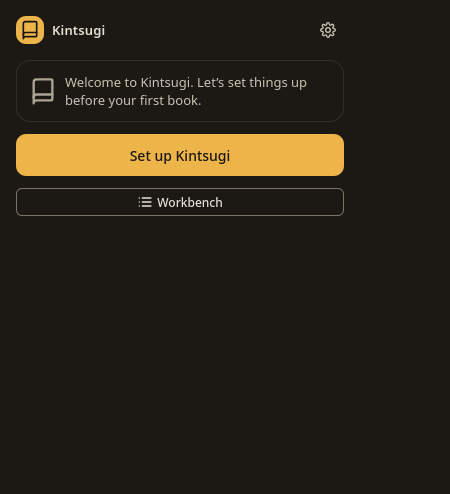
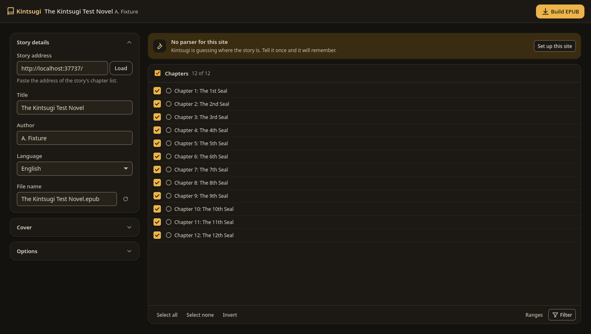
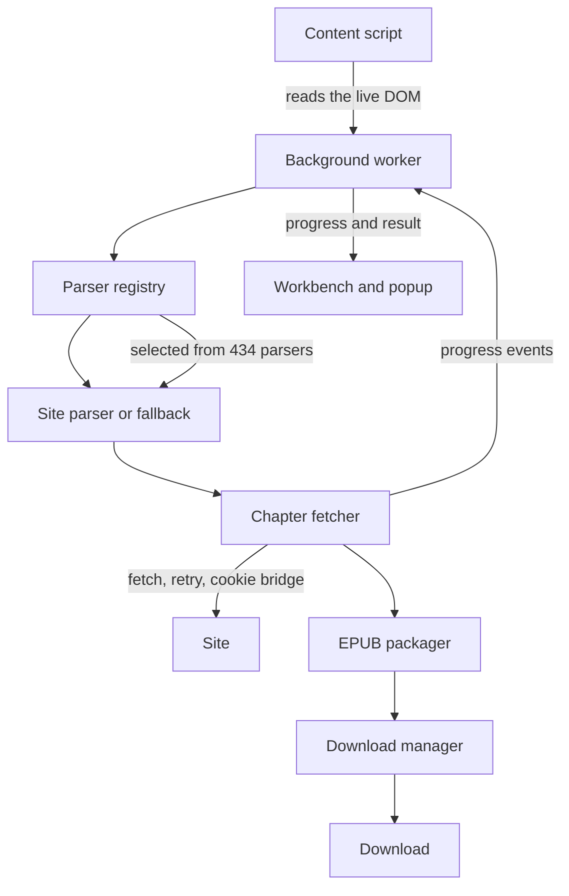

# Kintsugi

**Turn any web novel into a book worth keeping.**

Kintsugi is a Firefox extension that scrapes episodic web fiction and packs it
into clean, well-formed EPUB files. It is a from-scratch rewrite of
[WebToEpub](readme.md): the same 434 site parsers, the same parser contract,
a completely new interface, a smaller permission set, and a build you can
actually read.

It is built for people with a thousand-chapter serial open in eleven tabs, and
for people who want to keep the story after the site changes shape.

[](LICENSE.md)
[](docs/architecture/README.md)
[](docs/WORKLOG.md)
[](docs/permissions.md)

---

## Table of contents

- [See it in action](#see-it-in-action)
- [Why Kintsugi](#why-kintsugi)
- [Features](#features)
- [Install](#install)
- [Quick start](#quick-start)
- [How it works](#how-it-works)
- [Documentation](#documentation)
- [Development](#development)
- [Contributing](#contributing)
- [License](#license)
- [Security](#security)

---

## See it in action

**The popup** — a launcher, nothing more. It answers one question: can
Kintsugi do anything with this page?




**The workbench** — a full tab that owns the metadata, the chapter list, the
filters, the selection, and the download.




**Options** — themes, accent colour, language, library, and the per-site host
permissions you have granted.


**Onboarding** — three steps, once.


_These screenshots are generated from the running extension by
`tools/e2e-harness.mjs`, which drives a real Firefox over Marionette and
installs the built `dist/` as a temporary add-on. Nothing is mocked._

---

## Why Kintsugi

WebToEpub 1.x was a Chrome/Firefox extension whose entire product lived in one
cramped popup. Pick a parser, wait for a table-of-contents crawl, tick
chapters, build the EPUB, save it. One surface, ten toggling sections, and a
primary action thirteen rows below the fold.

Kintsugi splits that in two: a **popup that is only a launcher**, and a
**workbench** — a real tab that can hold a long download open.

|                            | **WebToEpub 1.x**                                                           | **Kintsugi 2.0**                                                             |
| -------------------------- | --------------------------------------------------------------------------- | ---------------------------------------------------------------------------- |
| **Where you work**         | One popup that does everything                                              | A launcher popup, plus a full workbench tab                                  |
| **Time to first feedback** | Popup re-opens itself in a tab; the popup flashes and vanishes              | Popup answers "is this supported?" in under a second; the tab opens directly |
| **Parsers loaded at once** | Every parser script in the popup's document                                 | None in the popup — the background worker owns all 434                       |
| **Theming**                | Dark mode as five inverted background rules                                 | Light, dark, and system themes, each designed, plus an accent colour         |
| **Keyboard support**       | Effectively none                                                            | Every action has a keyboard path; focus rings are a token, never removed     |
| **Languages**              | English only                                                                | English, French, German, Japanese, Indonesian — 186 keys each, none partial  |
| **Permissions**            | 7, including `webRequest`, `unlimitedStorage`, and a permanent `<all_urls>` | 5, no static host permissions; `*://*/*` is optional and granted per site    |
| **Bundle size**            | One 1090-line HTML file plus a 466-entry hand-maintained script list        | `dist/` ≈ 1.18 MB; packaged `.xpi` ≈ 337 KB                                  |

The permission reduction is the part worth being precise about. The original
held a permanent, install-time grant to every site you visit. Kintsugi holds
**no static host permissions at all**. When you pick a site, Firefox asks you
once, for that origin, and you can revoke it per site or entirely from the
options page. The reasoning is written out in
[`docs/permissions.md`](docs/permissions.md).

---

## Features

**Sites**

- **434 site parsers**, covering **659 host names**, migrated from the original
  without changing the parser contract.
- **Teach it your own site.** When no parser matches, the workbench says so
  and offers a split-view selector builder: _Suggest_, _Test_ against the live
  page, _Save_, _Forget_. The configuration persists and is listed in options.
- A heuristic fallback parser catches sites nobody wrote a parser for, and
  labels its output as a guess.

**The workbench**

- **Chapter filtering** by text or regular expression, with include and exclude
  terms, and a live match count.
- **Selection** by hand or in ranges — all, none, invert, or named ranges.
- **Metadata editing** for title, author, language, cover, and output filename,
  with a marker showing which fields were detected rather than typed.
- **Live progress** in the status bar and in the popup: phase, chapter count,
  percentage, cancel.
- **EPUB packaging** with cover, table of contents, sanitised chapter HTML,
  and a filename you control.

**Everything else**

- **A library** of saved books, in IndexedDB, with re-download and incremental
  update.
- **Site-selector persistence** — taught sites survive restarts and appear in
  their own options section.
- **Themes**: light, dark, or system, each a first-class design with its own
  surfaces, elevation, and accent tuning. Plus a choice of accent colour and
  a density setting.
- **Five languages**: English (source), French, German, Japanese, Indonesian —
  186 keys each, complete, with a catalogue test that fails on any gap.
- **No telemetry, no remote code, no account.** No server, no sync, no update
  check. Everything stays on your machine.

---

## Install

Kintsugi targets **Firefox** only, on Manifest V3.

### From a built `.xpi`

```bash
npm install
npm run build
npm run package
```

That writes `release/kintsugi-2.0.0-alpha.1/kintsugi-2.0.0-alpha.1.xpi`
(≈ 337 KB). Then:

1. Open `about:debugging#/runtime/this-firefox`.
2. Click **Load Temporary Add-on…**.
3. Pick the `.xpi` from `release/kintsugi-2.0.0-alpha.1/`.

The add-on stays installed until you restart Firefox or remove it.

### For development

```bash
npm run build
npx web-ext run --source-dir dist
```

This launches Firefox with the extension loaded and hot-reloads on rebuild.
`npm run web-ext:run` is the same thing.

### For release

A signed `.xpi` for distribution through addons.mozilla.org is produced by the
release workflow (`.github/workflows/release.yml`), which signs the package
with `web-ext sign` when the signing secrets are present and publishes it
unsigned otherwise. The artifact built locally is enough to try the extension;
a permanent install needs a signature.

---

## Quick start

1. **Open a chapter page** of a serial you read — a story index, a chapter,
   whatever the site links to.
2. **Click the Kintsugi icon.** The popup shows what it found: cover, title,
   author, chapter count. If the site is unsupported, it says so plainly.
3. **Open the workbench.** The toolbar button takes you straight to a tab
   where the chapter list is loaded and the metadata is prefilled.
4. **Filter and select.** Narrow the list with a search term or a regular
   expression, select the chapters you want, and adjust the title, author,
   language, cover, or filename if the detection was off.
5. **Press Pack EPUB.** Progress appears in the status bar and in the popup.
   When it finishes, the file is in your downloads folder — and in your
   library in options, if you kept it.

First run shows a three-step onboarding: welcome, pick your language, choose
a theme and accent.

---

## How it works

The one structural idea: **the worker owns the work; the page owns the
pixels.**



- The **content script** reads the live, JavaScript-rendered DOM. It is a
  reader: it extracts and sends back, and never modifies the page.
- The **background worker** owns the registry, the network layer, and the
  download. It is the only place that holds the parsers, which is what keeps
  the popup small — the popup ships no parser code at all.
- The **parser registry** maps a host name to one of 434 parsers, with a URL
  rule and a heuristic fallback behind it.
- The **chapter fetcher** handles retries, abort, scoped cookie bridging, and
  Cloudflare header rules.
- The **EPUB packager** builds a typed EPUB document and writes it with a
  lazily-zipped container, then the **download manager** hands it to Firefox.

The full picture — module map, message protocol, storage, error codes,
performance budget — is in
[`docs/architecture/README.md`](docs/architecture/README.md).

---

## Documentation

Everything the project knows about itself lives in `docs/`.

| Document                                                             | What it covers                                                                                                  |
| -------------------------------------------------------------------- | --------------------------------------------------------------------------------------------------------------- |
| [`docs/discovery/`](docs/discovery/01-product-inventory.md)          | What the original was, feature by feature, and the technical and UX audits it was rewritten from                |
| [`docs/design/`](docs/design/00-vision.md)                           | Vision and design principles, the design system, UX guidelines, and screen-by-screen specifications             |
| [`docs/architecture/`](docs/architecture/README.md)                  | The authoritative map of the system: layering, module map, pipeline, message protocol, storage, errors, budgets |
| [`docs/decisions/`](docs/decisions/ADR-0001-rewrite-from-scratch.md) | Twelve accepted architecture decision records, from the rewrite decision to lazy zipping                        |
| [`docs/permissions.md`](docs/permissions.md)                         | Every permission, why it exists, where it is used, and what it is not used for                                  |
| [`docs/WORKLOG.md`](docs/WORKLOG.md)                                 | The running record of decisions, progress, and open questions                                                   |
| [`PRIVACY.md`](PRIVACY.md)                                           | What is collected: nothing                                                                                      |
| [`SECURITY.md`](SECURITY.md)                                         | Security model and how to report a vulnerability privately                                                      |
| [`CONTRIBUTING.md`](CONTRIBUTING.md)                                 | Pull request checklist and contribution rules                                                                   |
| [`LICENSE.md`](LICENSE.md)                                           | GPL-3.0, in full                                                                                                |
| [`ROADMAP.md`](ROADMAP.md)                                           | Phases, milestones, and what is explicitly out of scope                                                         |

Three documents are still to be written and are therefore not linked here yet:
`docs/development.md`, `CHANGELOG.md`, and `CODE_OF_CONDUCT.md`.

---

## Development

```bash
npm install        # install dependencies
npm run verify     # lint + typecheck + tests + build + extension lint
npm run build      # build dist/
npm run web-ext:run  # launch Firefox with the extension loaded
npm test           # 155 unit and integration tests (vitest)
npm run test:e2e   # Playwright end-to-end checks against dist/
node tools/e2e-harness.mjs run   # Marionette checks against a real Firefox
```

The build is `esbuild`. The output goes to `dist/`, which is what
`web-ext` loads, what the E2E harness installs as a temporary add-on, and
what `npm run package` zips into the `.xpi`.

Testing has three layers: **vitest** for the domain logic, **Playwright** for
the end-to-end flows, and a **Marionette** harness (`tools/e2e-harness.mjs`)
that drives a real Firefox with the built extension installed as a temporary
add-on. The last layer is not a browser emulator — it is the artefact a user
installs.

A fuller development guide is planned as `docs/development.md`; until then,
[`CONTRIBUTING.md`](CONTRIBUTING.md) and [`docs/WORKLOG.md`](docs/WORKLOG.md)
are the reference.

---

## Contributing

Read [`CONTRIBUTING.md`](CONTRIBUTING.md) for the pull request checklist.
Two rules matter most: new behaviour must be **switchable and off by default**,
and adding a permission requires a written justification in
[`docs/permissions.md`](docs/permissions.md).

A `CODE_OF_CONDUCT.md` is planned and will be linked here when it lands.

## License

**GPL-3.0-only.** The full text is in [`LICENSE.md`](LICENSE.md). The original
WebToEpub was GPL-3.0 licensed, and this rewrite inherits that license.

## Security

Report vulnerabilities privately — see
[`SECURITY.md`](SECURITY.md). Do not open a public issue for a security
report.

Kintsugi ships no remote code, no telemetry, and no server. The manifest's
content security policy is `script-src 'self'; object-src 'none'; base-uri
'none'; frame-src 'none'`, and `data_collection_permissions.required` is
`["none"]`.
