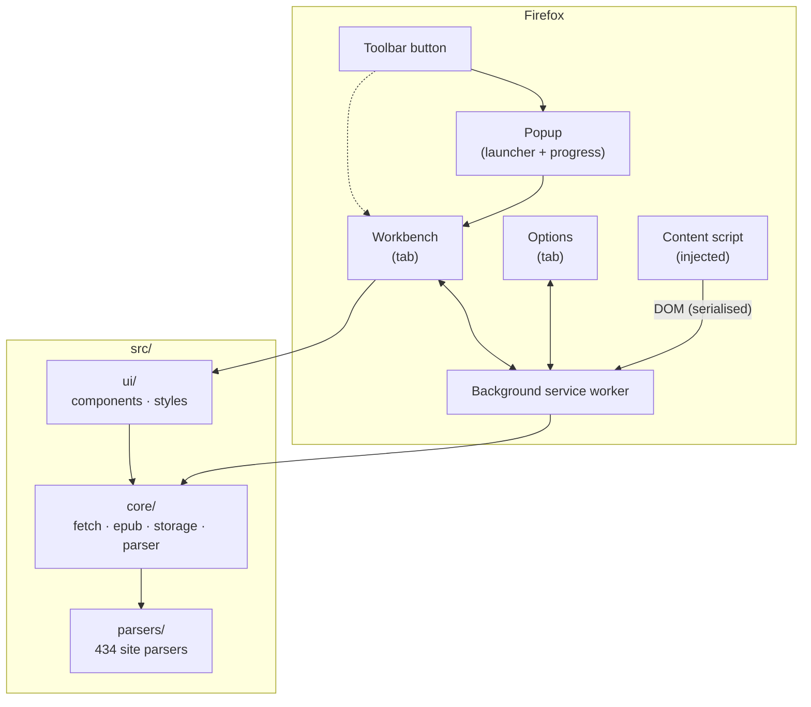
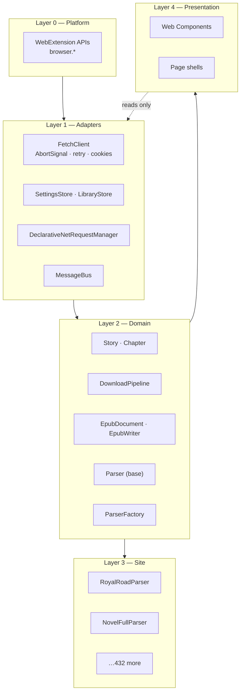
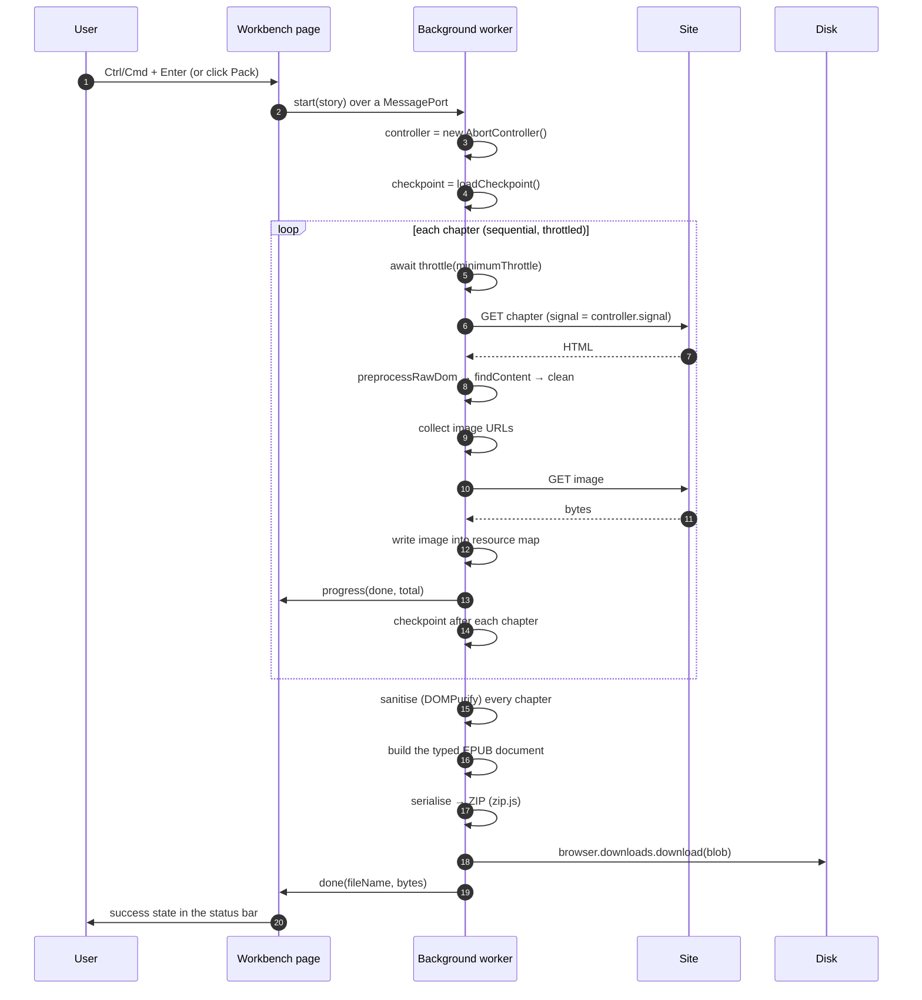
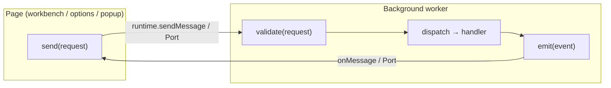
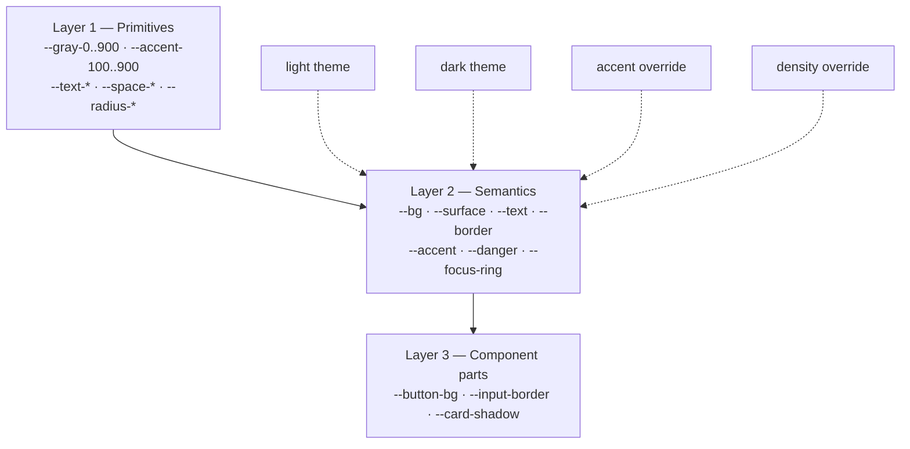
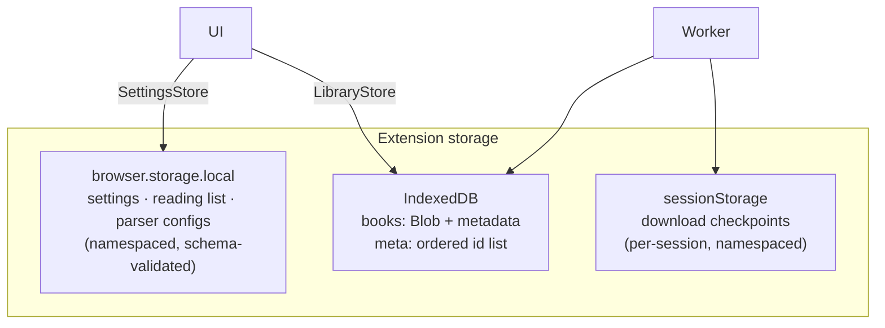
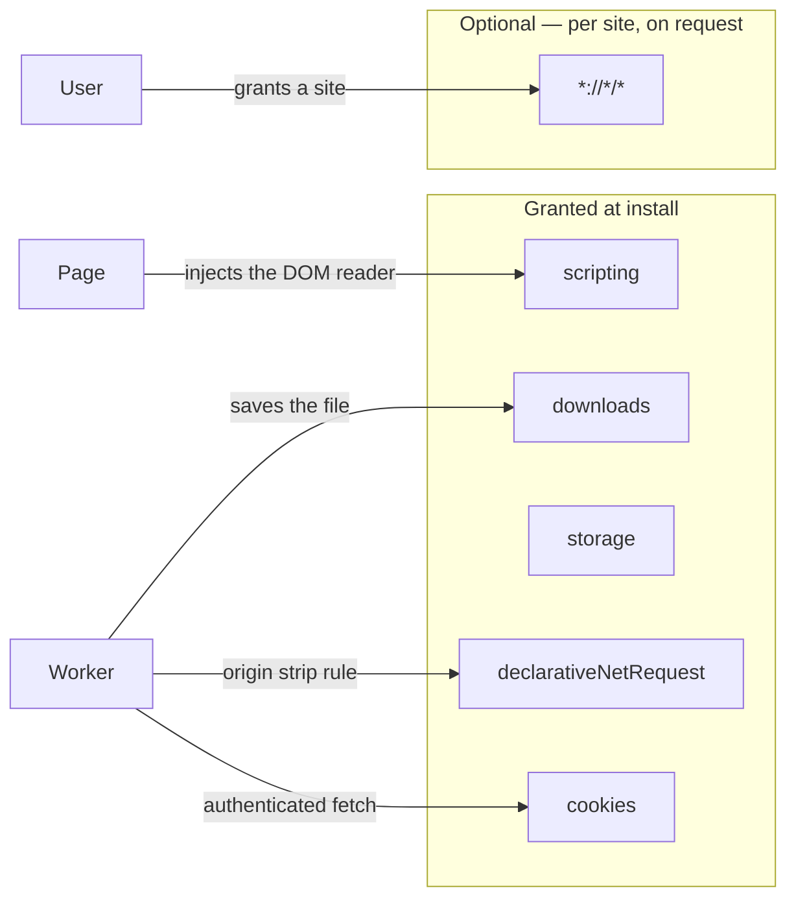

# Kintsugi — Architecture

Version 2.0 · Status: **authoritative**

This document describes how the revamped extension is put together. It is
the map you read before you change anything.

---

## 1. The shape of the system



**The one structural idea:** _the worker owns the work; the page owns the
pixels._ Everything else follows from that.

---

## 2. Layering



**The dependency rule:** dependencies point downward only. Layer 4 (the UI)
may _read_ from Layer 1 (adapters) for status, but never reaches into
Layer 2 internals, and Layer 3 (parsers) knows nothing about Layers 1 or 4
beyond the adapter surface it is handed.

**The parser boundary:** a parser implements the `Parser` interface and is
handed a `ParserContext` containing the adapters it needs. It cannot reach
the DOM of another layer, cannot touch storage directly, and cannot render
anything.

---

## 3. Module map

### 3.1 `src/core/` — the domain

| Module                            | Responsibility                                                                                                                          |
| --------------------------------- | --------------------------------------------------------------------------------------------------------------------------------------- |
| `background.ts`                   | The service worker entry point: message routing, download orchestration, and the parser registry's lifetime.                            |
| `browser-api.ts`                  | The single place that touches `browser.*`. Every other module goes through it, so the extension's API surface is auditable in one file. |
| `content-script.ts`               | The injected script: extracts the page's DOM and hands it to the worker.                                                                |
| `download-manager.ts`             | Owns the running downloads, their progress, and their cancellation.                                                                     |
| `epub/document.ts`                | The typed EPUB document model.                                                                                                          |
| `epub/writer.ts`                  | Serialise the model, canonically.                                                                                                       |
| `epub/packer.ts`                  | Assemble the model into a container.                                                                                                    |
| `message/bus.ts`                  | The typed request/response and event channels between the pages and the worker.                                                         |
| `net/fetch-client.ts`             | `fetch`, `fetchJson`, `fetchText`, `fetchHtml`. Owns the `AbortController`, the retry policy, and the cookie scoping.                   |
| `net/cookie-bridge.ts`            | Partitioned → unpartitioned cookie bridging, with `finally` cleanup.                                                                    |
| `net/dnr-rules.ts`                | The declarativeNetRequest rule manager (static rules, additive, scoped).                                                                |
| `parser/parser.ts`                | The abstract `Parser` class, the chapter-fetch orchestration, and the DOM → content pipeline.                                           |
| `parser/registry.ts`              | The parser registry and the selection strategy (host → URL rule → confidence rule → default).                                           |
| `parser/default-parser.ts`        | The heuristic fallback parser.                                                                                                          |
| `parser/heuristic-scanner.ts`     | The heuristic that finds a chapter list and the content of a chapter page.                                                              |
| `parser/constructed-content.ts`   | Builds a synthetic document for parsers that produce content from JSON rather than from HTML.                                           |
| `parser/register-all.ts`          | Registers every site parser. Generated from the filesystem at build time.                                                               |
| `parser/legacy-parsers.ts`        | The bridge to the preserved legacy parsers.                                                                                             |
| `parser/compat/*`                 | The compatibility shims that give the legacy parsers the globals they expect (see ADR-0002).                                            |
| `storage/settings-store.ts`       | `SettingsStore`: schema-validated settings in `browser.storage.local`.                                                                  |
| `storage/library-store.ts`        | `LibraryStore`: IndexedDB, transactional.                                                                                               |
| `storage/site-selectors-store.ts` | The user's saved selectors, per site.                                                                                                   |
| `storage/site-selectors.ts`       | The selector model and its validation.                                                                                                  |
| `util/*`                          | Focused utilities: `dom.ts`, `css.ts`, `text.ts` (`primitives.ts`), `errors.ts`, `sanitize.ts`, `parser-utilities.ts`.                  |
| `vendor/dompurify.ts`             | The vendored DOMPurify build (see §3.4).                                                                                                |

### 3.2 `src/ui/` — the presentation

| Module                       | Responsibility                                                           |
| ---------------------------- | ------------------------------------------------------------------------ |
| `styles/tokens.css`          | Layer 1 primitives + Layer 2 semantics for both themes.                  |
| `styles/base.css`            | Resets, typography defaults, the app shell, the focus policy.            |
| `styles/theme-controller.ts` | Resolves "system" to a theme and applies the attributes on `<html>`.     |
| `components/base.ts`         | `KComponent`: the shadow root, the adopted stylesheet, the a11y helpers. |
| `components/k-*.ts`          | The 13 Web Components (`k-button`, `k-field`, `k-dialog`, `k-list`, …).  |
| `components/icons.ts`        | The icon set — 24×24, 2 px stroke, `currentColor`.                       |
| `pages/popup/`               | The popup: the launcher and the live progress indicator.                 |
| `pages/workbench/`           | The workbench page: mounts the components, owns the view state.          |
| `pages/options/`             | The options page: settings, library, reading list, site permissions.     |
| `pages/onboarding/`          | The first-run experience.                                                |
| `i18n.ts`                    | `t(key, subs)` — memoised, substitution-based.                           |
| `i18n-bootstrap.ts`          | Installs the `browser.i18n` catalogue before the first render.           |

### 3.3 `src/core/parsers/legacy/` — the sites

434 site parser modules, one per site family, preserved from the original and
wrapped by the compatibility shims. The build generates the registry from the
filesystem, so there is no hand-maintained list. See
[ADR-0002](../decisions/ADR-0002-parser-contract.md).

### 3.4 Vendored dependencies

Two third-party libraries are vendored into `src/core/vendor/`, rather than
being bundled from `node_modules` at build time:

| Library          | Where it is used                        | Why it is vendored                                                                                            |
| ---------------- | --------------------------------------- | ------------------------------------------------------------------------------------------------------------- |
| DOMPurify        | `src/core/vendor/dompurify.ts`          | The build must produce a browser bundle with no bundler in the hot path.                                      |
| `@zip.js/zip.js` | `src/core/parsers/compat/legacy-zip.ts` | Loaded lazily, behind a facade, so 155 KB of ZIP code is fetched only by the parser that needs it (ADR-0012). |

Both are MIT-licensed. Their licences are reproduced in `LICENSE.md`.

### 3.5 `tests/support/` — the test tree's own helpers

Helpers that exist only to prove the code works live here, not in `src/`:

| Helper           | What it is for                                                                                                                                             |
| ---------------- | ---------------------------------------------------------------------------------------------------------------------------------------------------------- |
| `epub-reader.ts` | Parses a written EPUB back into the document model, so the round trip — write, read, compare — can be asserted (see `tests/unit/epub-round-trip.test.ts`). |

Kintsugi writes EPUBs; it never reads them. The reader exists so the tests can
show that what was written is what comes back, and it is deliberately kept out
of the shipped tree so nothing dead rides along in the bundle.

---

## 4. The download pipeline

This is the sequence that produces an EPUB. It runs **in the background
service worker**.



**Key properties**

- **Sequential and throttled.** `maxSimultanousFetchSize` is 1 and
  `minimumThrottle` defaults to 500 ms. This is politeness, not a tuning
  knob — it is not configurable by the user beyond a floor.
- **Cancel is real.** `controller.abort()` aborts the in-flight `fetch`
  _and_ the throttle delay.
- **Checkpoints after every chapter.** A worker restart or browser crash
  resumes from the last completed chapter.
- **Deterministic output.** The same book built twice differs only in the
  OPF timestamp.

---

## 5. The message protocol

Every cross-context message is a **discriminated union** validated at the
boundary by a hand-written type guard. There is no `any` on this path.



```ts
// Requests (page → worker)
type Request =
    | { type: "story.analyse"; url: string }
    | { type: "download.start"; story: StoryDescriptor }
    | { type: "download.cancel" }
    | { type: "download.resume" }
    | { type: "library.list" }
    | { type: "library.put"; record: LibraryRecord }
    | { type: "library.delete"; id: string }
    | { type: "settings.get" }
    | { type: "settings.set"; patch: DeepPartial<Settings> };

// Events (worker → page)
type Event =
    | {
          type: "progress";
          phase: Phase;
          done: number;
          total: number;
          label: string;
      }
    | { type: "chapter.state"; sourceUrl: string; state: ChapterState }
    | { type: "done"; fileName: string; bytes: number }
    | { type: "error"; error: UserFacingError }
    | { type: "settings.changed"; settings: Settings };
```

---

## 6. The design system in code



A theme, an accent, and a density are **three overrides of Layer 2**. No
component CSS changes. This is enforced by
[ADR-0003](../decisions/ADR-0003-design-system.md).

---

## 7. Storage



`browser.storage.local` for small, structured, schema-validated settings.
IndexedDB for the library, because it stores **bytes** transactionally and
needs no blanket quota permission
([ADR-0006](../decisions/ADR-0006-storage.md)).

---

## 8. Permissions and network reach



See [ADR-0007](../decisions/ADR-0007-permissions.md) for the
permission-by-permission justification and the rationale document in
[`docs/permissions.md`](../permissions.md).

---

## 9. Error handling

Every failure crosses the boundary as a `UserFacingError`:

```ts
interface UserFacingError {
    /** A sentence a user can act on. Never a stack trace. */
    message: string;
    /** Machine-readable cause, for logs and tests. */
    code: ErrorCode;
    /** The URL involved, when relevant. */
    url?: string;
    /** Actions the UI may offer. */
    actions?: Array<{ id: string; label: string }>;
    /** Technical detail, shown only behind a disclosure. */
    detail?: string;
}
```

The mapping from a technical failure to a `UserFacingError` is a **single
pure function**, so it is exhaustively testable. The UI never renders a
`message.stack`.

---

## 10. Error codes

| Code                | Cause                                     | User-facing message                               | Offered actions          |
| ------------------- | ----------------------------------------- | ------------------------------------------------- | ------------------------ |
| `NETWORK`           | The request failed at the transport level | "Could not reach `site.com`."                     | Retry, Cancel            |
| `HTTP_STATUS`       | A non-2xx response                        | "`site.com` returned 503."                        | Retry, Open URL          |
| `RATE_LIMITED`      | HTTP 429                                  | "`site.com` is rate limiting requests."           | Retry later, Cancel      |
| `CHALLENGE`         | A captcha / bot-check page                | "This site is asking the browser to verify you."  | Open URL, Retry          |
| `EMPTY_CONTENT`     | The page had no extractable content       | "Chapter 42 came back empty."                     | Skip, Retry              |
| `TOO_MANY_CHAPTERS` | The book exceeds the configured cap       | "This book has 3 218 chapters; the limit is 500." | Raise limit, Cancel      |
| `STORAGE_FULL`      | The disk or quota is full                 | "There is not enough space to save this book."    | —                        |
| `PARSE_FAILED`      | The page could not be parsed              | "Could not read the chapter list on this page."   | Use the selector builder |
| `CANCELLED`         | The user cancelled                        | "Download cancelled."                             | —                        |

---

## 11. Performance budget

| Metric                          | Budget                          | How it is met                                                                         |
| ------------------------------- | ------------------------------- | ------------------------------------------------------------------------------------- |
| Popup open to interactive       | < 100 ms                        | Lazy message lookup; the popup ships no parser code                                   |
| Workbench open to interactive   | < 400 ms                        | The parser for the current host is code-split and loaded on demand                    |
| Chapter list with 5 000 rows    | 60 fps scrolling                | Virtualised list; ~30 DOM nodes at any time                                           |
| Memory for a 3 000-chapter book | < 300 MB                        | Chapters are converted to XHTML and released; the raw DOM is dropped after extraction |
| Bundle size                     | < 400 KB gzipped, excl. parsers | `zip.js` + DOMPurify are the only runtime dependencies                                |
| Cold install → first EPUB       | < 90 s for 100 chapters         | Sequential + throttled by design; the throttle is the floor, not a bug                |

---

## 12. Security posture

| Concern                   | Measure                                                                                                                      |
| ------------------------- | ---------------------------------------------------------------------------------------------------------------------------- |
| XSS in the extension page | No `innerHTML` with untrusted content. DOMPurify at the EPUB boundary _and_ at every DOM insertion point in the UI.          |
| Content Security Policy   | `script-src 'self'; object-src 'none'; base-uri 'none'` — no inline scripts, no remote code.                                 |
| Remote code               | None. The extension ships all of its code.                                                                                   |
| Prototype pollution       | Structured-clone storage values; schemas validated on read; no `Object.assign` of parsed JSON onto a live object.            |
| URL injection             | Every URL a parser returns is validated (`new URL`, scheme allow-list, same registrable domain unless explicitly permitted). |
| Regex denial of service   | User-supplied patterns are compiled with a length cap and executed with a timeout, and validated before use.                 |
| Cookie leakage            | Unpartitioned copies are removed in a `finally`, scoped to the registrable domain of the URL being fetched.                  |
| Sensitive data            | No telemetry, no accounts, no sync. `data_collection_permissions: { required: ["none"] }`.                                   |
| Third-party requests      | Only the site being read, plus an explicitly opt-in metadata lookup.                                                         |

---

## 13. Related documents

- [Discovery: product inventory](../discovery/01-product-inventory.md)
- [Discovery: technical audit](../discovery/02-audit-technical.md)
- [Discovery: UX audit](../discovery/03-audit-ux.md)
- [Design system](../design/01-design-system.md)
- [UX guidelines](../design/02-ux-guidelines.md)
- [ADRs](../decisions/README.md)
- [Permissions rationale](../permissions.md)
- [Development guide](../development.md)
